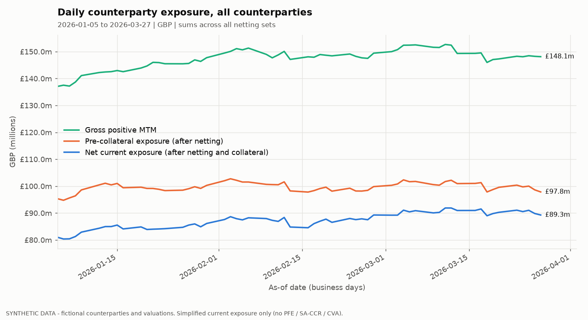
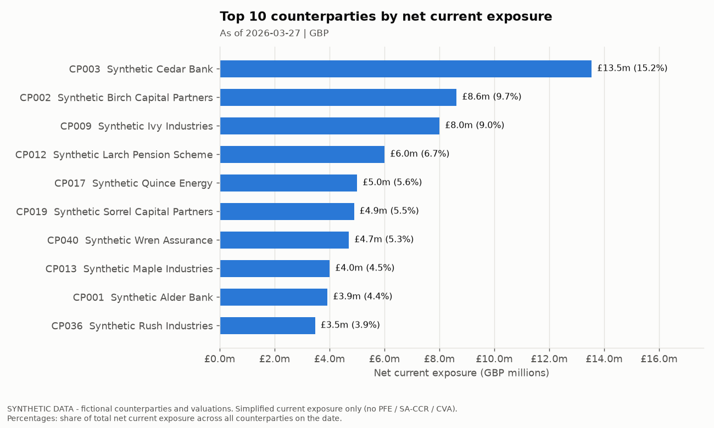
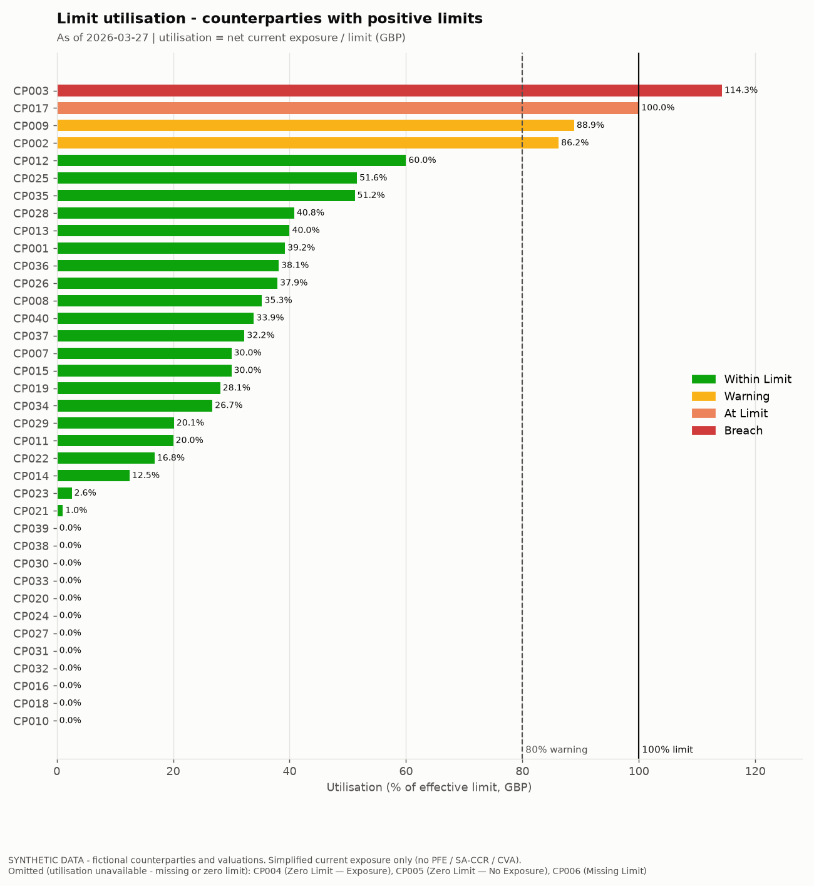
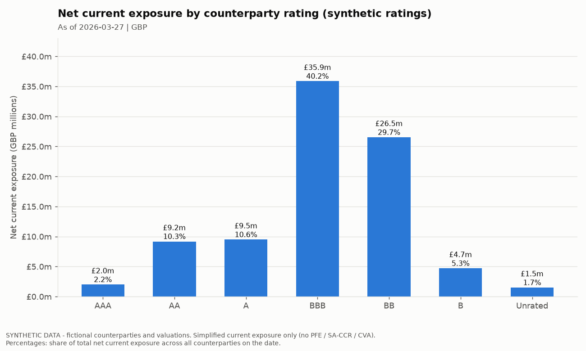
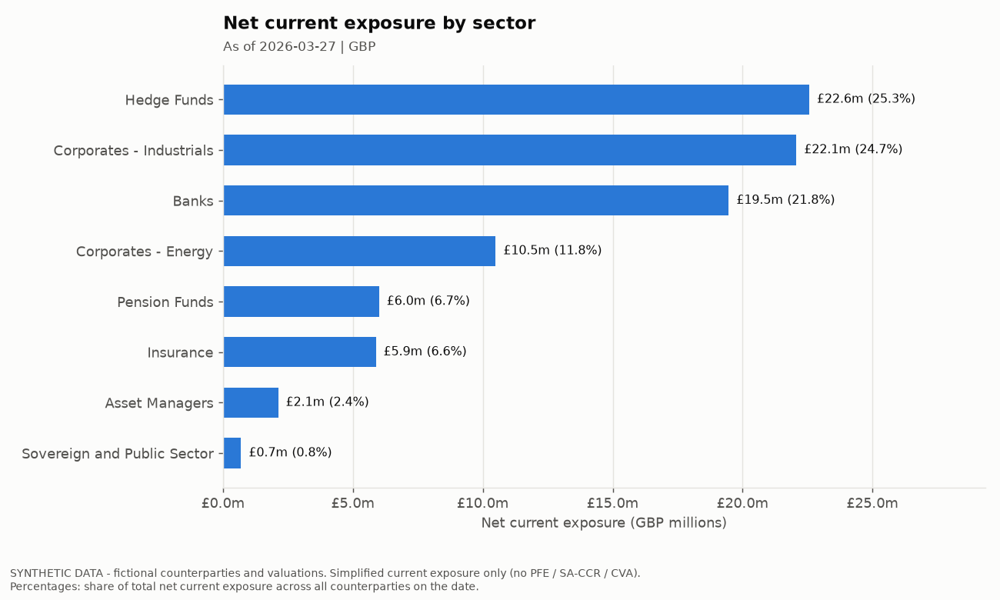
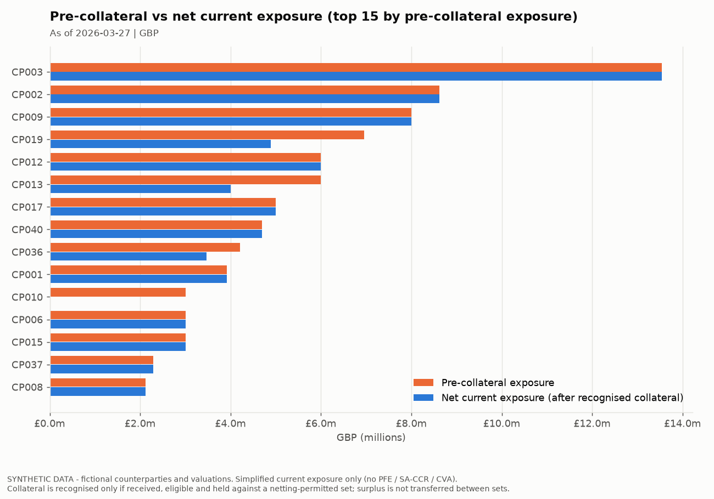
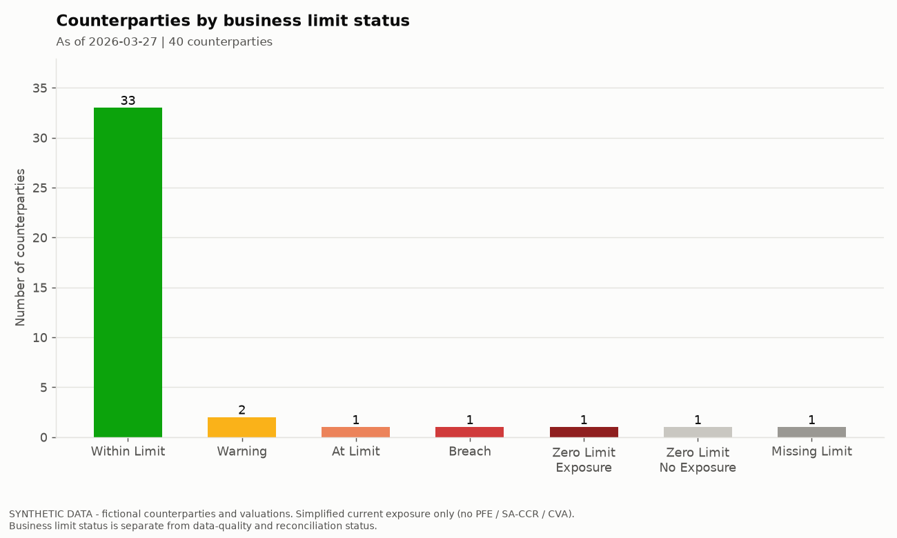

# Counterparty Credit Exposure and Limit Monitoring: Management Report

> **SYNTHETIC DATA.** All counterparties, trades, valuations, collateral, ratings, limits and results in this report are fictional and generated for demonstration. They do not describe any real institution. The exposure measure is a simplified current-exposure view (no potential future exposure, SA-CCR, regulatory EAD, CVA, expected credit loss or capital).

- **Latest as-of date:** 2026-03-27
- **History covered:** 2026-01-05 to 2026-03-27 (60 business dates; Monday-Friday index, not a holiday calendar)
- **Reporting currency:** GBP
- **Run ID:** `baseline-7e6d46ebd870`
- **Run status:** `SUCCESS`: All source and arithmetic reconciliation controls passed and no source records were quarantined.
- **Pipeline execution (UTC):** 2026-11-15T10:21:39+00:00
- **Report generated (UTC):** 2026-11-15T10:21:42+00:00

## 1. Population completeness

No source records were quarantined. The exposure population is complete relative to the supplied (synthetic) source extract.

Across the reporting window, 22,485 accepted trade snapshots were split into 22,359 included and 126 excluded snapshots (by documented rule: MATURITY_ON_OR_BEFORE_AS_OF: 28, STATUS_MATURED: 84, STATUS_TERMINATED: 14). Excluded snapshots are matured/terminated trades or trades on/after their maturity date; they are not data errors.

## 2. Key metrics

| Measure | 2026-03-27 | 2026-03-26 | Change |
|---|---|---|---|
| Gross positive MTM | £148.12m | £148.24m | -£0.13m |
| Netting benefit | £50.28m | £49.63m | £0.65m |
| Pre-collateral exposure | £97.84m | £98.61m | -£0.78m |
| Recognised collateral (after haircuts) | £14.05m | £14.40m | -£0.35m |
| Collateral benefit | £8.57m | £8.79m | -£0.22m |
| **Net current exposure** | £89.26m | £89.82m | -£0.56m |

- Counterparties in scope: 40; with positive net exposure: 27; netting sets: 50.
- Included trade snapshots on 2026-03-27: 365.
- Top-10 share of total net current exposure: 69.6% (denominator: total net current exposure of all counterparties on the date).
- Day-on-day change in net current exposure: -£0.56m (-0.62%).

## 3. Limit monitoring (latest date)

| Limit status | Counterparties |
|---|---|
| Breach | 1 |
| At Limit | 1 |
| Warning | 2 |
| Within Limit | 33 |
| Zero Limit — Exposure | 1 |
| Zero Limit — No Exposure | 1 |
| Missing Limit | 1 |

### Breaches

| counterparty_id | counterparty_name | net_current_exposure_gbp | limit_currency | limit_amount | limit_gbp | utilisation_pct | headroom_gbp |
|---|---|---|---|---|---|---|---|
| CP003 | Synthetic Cedar Bank | £13,542,144 | EUR | 14,000,000 | £11,849,376 | 114.3% | -£1,692,768 |

### At limit

| counterparty_id | counterparty_name | net_current_exposure_gbp | limit_currency | limit_amount | limit_gbp | utilisation_pct | headroom_gbp |
|---|---|---|---|---|---|---|---|
| CP017 | Synthetic Quince Energy | £5,000,000 | GBP | 5,000,000 | £5,000,000 | 100.0% | £0 |

### Warnings (utilisation at or above the warning threshold)

| counterparty_id | counterparty_name | net_current_exposure_gbp | limit_currency | limit_amount | limit_gbp | utilisation_pct | headroom_gbp |
|---|---|---|---|---|---|---|---|
| CP002 | Synthetic Birch Capital Partners | £8,622,736 | GBP | 10,000,000 | £10,000,000 | 86.2% | £1,377,264 |
| CP009 | Synthetic Ivy Industries | £8,000,000 | GBP | 9,000,000 | £9,000,000 | 88.9% | £1,000,000 |

### Zero limit with exposure

| counterparty_id | counterparty_name | net_current_exposure_gbp | limit_currency | limit_amount | limit_gbp | utilisation_pct | headroom_gbp |
|---|---|---|---|---|---|---|---|
| CP004 | Synthetic Damson Bank | £2,000,000 | GBP | 0 | £0 | n/a | -£2,000,000 |

### Zero limit, no exposure

| counterparty_id | counterparty_name | net_current_exposure_gbp | limit_currency | limit_amount | limit_gbp | utilisation_pct | headroom_gbp |
|---|---|---|---|---|---|---|---|
| CP005 | Synthetic Elm Energy | £0 | GBP | 0 | £0 | n/a | £0 |

### Missing effective limit

| counterparty_id | counterparty_name | net_current_exposure_gbp | limit_currency | limit_amount | limit_gbp | utilisation_pct | headroom_gbp |
|---|---|---|---|---|---|---|---|
| CP006 | Synthetic Fir Industries | £3,000,000 | n/a | n/a | n/a | n/a | n/a |

Utilisation is shown only for positive limits; for missing or zero limits it is unavailable (n/a), not 0%. Negative headroom means exposure exceeds the limit. A missing limit is a monitoring gap, not evidence of compliance.

### Breach history over the window

| counterparty_id | first_breach_date | last_breach_date | breach_dates |
|---|---|---|---|
| CP003 | 2026-03-09 | 2026-03-27 | 15 |

Over 60 dates: breach counterparty-days 15, warning counterparty-days 117, at-limit counterparty-days 60, missing-limit counterparty-days 30, zero-limit-with-exposure counterparty-days 60.

## 4. Top-10 counterparty concentration (latest date)

| rank | counterparty_id | counterparty_name | rating | sector | net_current_exposure_gbp | share_of_total_net_exposure_pct | cumulative_share_pct | limit_status |
|---|---|---|---|---|---|---|---|---|
| 1 | CP003 | Synthetic Cedar Bank | BBB | Banks | £13,542,144 | 15.2% | 15.2% | Breach |
| 2 | CP002 | Synthetic Birch Capital Partners | BB | Hedge Funds | £8,622,736 | 9.7% | 24.8% | Warning |
| 3 | CP009 | Synthetic Ivy Industries | BBB | Corporates - Industrials | £8,000,000 | 9.0% | 33.8% | Warning |
| 4 | CP012 | Synthetic Larch Pension Scheme | BB | Pension Funds | £6,000,000 | 6.7% | 40.5% | Within Limit |
| 5 | CP017 | Synthetic Quince Energy | A | Corporates - Energy | £5,000,000 | 5.6% | 46.1% | At Limit |
| 6 | CP019 | Synthetic Sorrel Capital Partners | AA | Hedge Funds | £4,886,096 | 5.5% | 51.6% | Within Limit |
| 7 | CP040 | Synthetic Wren Assurance | B | Insurance | £4,699,584 | 5.3% | 56.9% | Within Limit |
| 8 | CP013 | Synthetic Maple Industries | BBB | Corporates - Industrials | £4,000,000 | 4.5% | 61.3% | Within Limit |
| 9 | CP001 | Synthetic Alder Bank | BB | Banks | £3,920,543 | 4.4% | 65.7% | Within Limit |
| 10 | CP036 | Synthetic Rush Industries | BBB | Corporates - Industrials | £3,469,380 | 3.9% | 69.6% | Within Limit |

Shares use total net current exposure across all counterparties on the date as the denominator.

## 5. Exposure by rating and sector (latest date)

### By rating

| rating | counterparty_count | counterparties_with_exposure | net_current_exposure_gbp | share_of_total_net_exposure_pct |
|---|---|---|---|---|
| AAA | 1 | 1 | £2,000,000 | 2.2% |
| AA | 4 | 3 | £9,175,319 | 10.3% |
| A | 5 | 4 | £9,490,144 | 10.6% |
| BBB | 16 | 10 | £35,874,761 | 40.2% |
| BB | 10 | 7 | £26,523,450 | 29.7% |
| B | 3 | 1 | £4,699,584 | 5.3% |
| Unrated | 1 | 1 | £1,500,000 | 1.7% |

`Unrated` = no effective rating record on the date (flagged as a data-quality warning).

### By sector

| sector | counterparty_count | counterparties_with_exposure | net_current_exposure_gbp | share_of_total_net_exposure_pct |
|---|---|---|---|---|
| Hedge Funds | 10 | 7 | £22,560,123 | 25.3% |
| Corporates - Industrials | 8 | 6 | £22,068,339 | 24.7% |
| Banks | 3 | 3 | £19,462,687 | 21.8% |
| Corporates - Energy | 5 | 4 | £10,490,144 | 11.8% |
| Pension Funds | 3 | 1 | £6,000,000 | 6.7% |
| Insurance | 5 | 2 | £5,876,192 | 6.6% |
| Asset Managers | 2 | 1 | £2,115,960 | 2.4% |
| Sovereign and Public Sector | 4 | 3 | £689,812 | 0.8% |

Country and parent-group breakdowns are in `exposure_by_country.csv` and `exposure_by_parent.csv`. Parent-group exposure is descriptive only; no group limits were supplied, so no group-limit test is performed.

## 6. Exposure movement

Net current exposure moved from £80.99m on 2026-01-05 to £89.26m on 2026-03-27. Window minimum £80.35m, maximum £91.87m.

### Largest increases, 2026-03-26 to 2026-03-27

| counterparty_id | change_gbp |
|---|---|
| CP036 | £281,392 |
| CP035 | £141,407 |
| CP003 | £121,205 |
| CP022 | £58,036 |
| CP028 | £22,959 |

### Largest decreases, 2026-03-26 to 2026-03-27

| counterparty_id | change_gbp |
|---|---|
| CP021 | -£284,798 |
| CP029 | -£225,638 |
| CP037 | -£203,313 |
| CP019 | -£114,928 |
| CP026 | -£106,108 |

## 7. Reconciliation

2777 of 2777 controls passed; 0 failed.

| control_id | control_name | controls | passed | failed |
|---|---|---|---|---|
| C01 | SOURCE_ROW_COUNT | 426 | 426 | 0 |
| C02 | SOURCE_AMOUNT_TOTAL | 363 | 363 | 0 |
| C03 | QUARANTINE_BRIDGE | 128 | 128 | 0 |
| C04 | TRADE_INCLUSION_BRIDGE | 60 | 60 | 0 |
| C05 | TRADE_TO_NETTING_SET_COUNT | 60 | 60 | 0 |
| C05 | TRADE_TO_NETTING_SET_GROSS_POSITIVE | 60 | 60 | 0 |
| C05 | TRADE_TO_NETTING_SET_SIGNED_MTM | 60 | 60 | 0 |
| C06 | COLLATERAL_CLASSIFICATION_COUNT | 60 | 60 | 0 |
| C06 | COLLATERAL_SINGLE_ALLOCATION | 60 | 60 | 0 |
| C06 | RECOGNISED_COLLATERAL_TO_NETTING_SET | 60 | 60 | 0 |
| C07 | NETTING_BENEFIT_BRIDGE | 60 | 60 | 0 |
| C08 | COLLATERAL_BENEFIT_BRIDGE | 60 | 60 | 0 |
| C08 | NON_NEGATIVE_EXPOSURE | 60 | 60 | 0 |
| C09 | NETTING_SET_TO_COUNTERPARTY | 300 | 300 | 0 |
| C10 | COUNTERPARTY_TO_DAILY_SUMMARY | 360 | 360 | 0 |
| C11 | BREAKDOWN_SHARE_TOTAL | 240 | 240 | 0 |
| C11 | BREAKDOWN_TOTAL | 240 | 240 | 0 |
| C11 | TOP_N_CONCENTRATION | 60 | 60 | 0 |
| C11 | TOP_N_TO_DAILY_SUMMARY | 60 | 60 | 0 |

Passing arithmetic controls shows that the reported totals are internally consistent with the source extract and its control totals. It does not prove that the source data are true, that valuations are economically correct, or that netting is legally enforceable. Limit breaches are business outcomes, not reconciliation failures.

## 8. Data-quality and business warnings

| severity | issue_class | check | rows |
|---|---|---|---|
| WARNING | BUSINESS | INELIGIBLE_COLLATERAL | 1 |
| WARNING | BUSINESS | LIMIT_BREACH | 1 |
| WARNING | BUSINESS | MISSING_LIMIT | 1 |
| WARNING | BUSINESS | POSTED_COLLATERAL | 2 |
| WARNING | BUSINESS | ZERO_LIMIT_NO_EXPOSURE | 1 |
| WARNING | BUSINESS | ZERO_LIMIT_WITH_EXPOSURE | 1 |
| WARNING | DATA_QUALITY | MISSING_RATING | 1 |
| WARNING | DATA_QUALITY | UNSUPPORTED_COLLATERAL_NON_NETTING_SET | 1 |

Each warning row summarises one counterparty or collateral item over the dates affected; see `data_quality_issues.csv`.

## 9. Charts

### Daily exposure trend

### Top-10 counterparties (latest date)

### Limit utilisation (positive limits only)

### Exposure by rating

### Exposure by sector

### Pre-collateral vs net exposure

### Counts by limit status

## 10. Assumptions and limitations

- All data are synthetic; MTM values are supplied inputs, not priced.
- Current exposure only: no potential future exposure, SA-CCR, regulatory EAD, CVA, expected credit loss or capital.
- `netting_permitted` is a synthetic modelling flag, not a legal opinion on enforceability.
- Collateral is recognised only if received, eligible and held against a netting-permitted set, at market value x FX x (1 - haircut). No thresholds, minimum transfer amounts, margin period of risk or wrong-way risk.
- Surplus collateral in one netting set is not transferred to another set or counterparty.
- Trades are included only if ACTIVE with maturity date strictly after the as-of date.
- FX: same-date `gbp_per_unit` rates; GBP = 1.
- Limits and ratings are selected with effective_from <= as-of date < effective_to; no future records are used.
- Business dates are a Monday-Friday index, not an exchange holiday calendar.
- This is a repeatable pipeline run on demand, not a scheduled production service.
